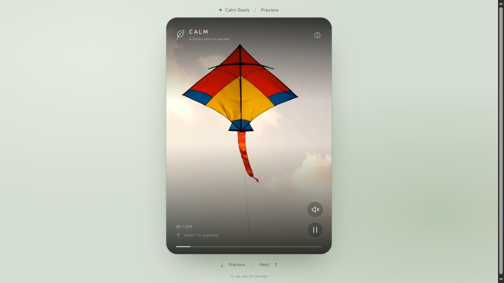
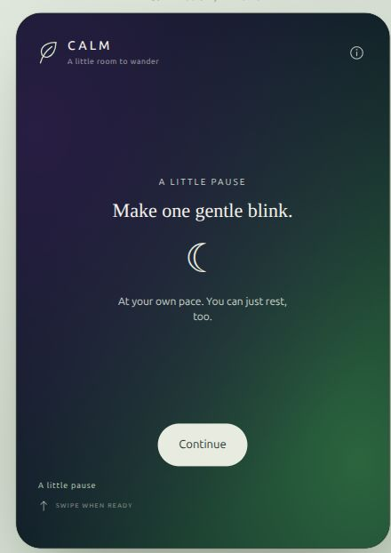
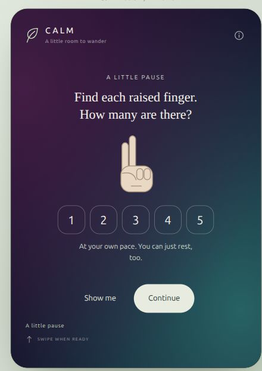
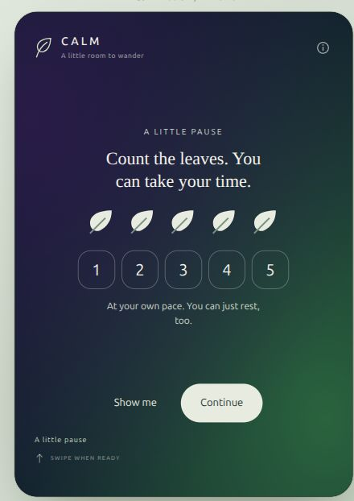
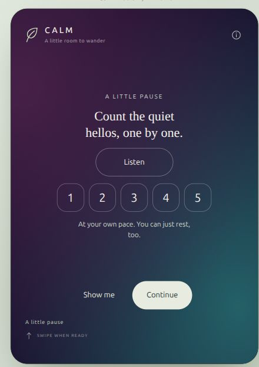
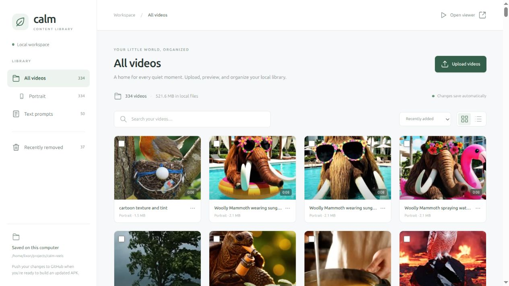
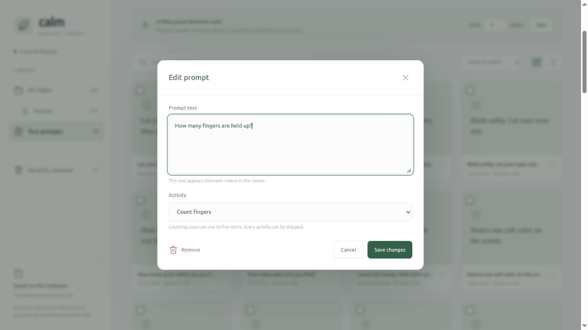

# Calm Reels

**A little room to wander.**

Calm Reels is an offline Flutter app for a collection of AI-generated, nature-inspired shorts: animals, plants, tiny worlds, and soft everyday scenes. Swipe upward to explore a shuffled portrait feed. Small, optional activities appear between the videos.

[Download the Android APK](https://github.com/lixonic/calm-shorts/releases/latest/download/Calm-Reels.apk) · [Open the local preview](http://127.0.0.1:8767/preview/) · [Build and content guide](docs/BUILD.md)

## The idea behind the “biophilic AI slop”

The starting idea was deliberately simple: take roughly **45 minutes of biophilic AI slop** and give it a quiet place to live. A fox on a beach, a miniature forest, an unlikely animal doing something ordinary—little generated moments that can be pleasant to look at without needing a story.

“AI slop” is a candid description of the material. These clips are synthetic, sometimes strange, and imperfect. Nature, animals, and gentle movement provide the visual direction. The collection can be edited whenever a clip feels too busy or distracting.

The interface follows that same small ambition. Give each video room. Keep the controls simple. Make the collection finite. Let a child pause, skip, revisit, or stop. There are no likes, comments, scores, or streaks competing for attention.

The app is designed for calm viewing and winding down. Its effect on sleep has not been measured. Every activity is an invitation that can be left unfinished.

## What is in the current collection

| Content | Current amount |
| --- | --- |
| Portrait videos | **334** |
| Video-only running time | **50 minutes 42 seconds** |
| Quiet pauses | **20** |
| Counting, listening, and memory activities | **30** |
| Default spacing | One pause after every **5 videos** |
| Prepared media | About **527 MB**, before app code and Android libraries |

The original “45 minutes” describes the idea; the library has grown with new additions. Optional pauses add as much time as the child chooses to spend on them.

## The actual preview

These screenshots were captured from the running local browser preview on **13 October 2026**. They show the real collection and working activity cards. The browser preview uses the same video and prompt catalogs as the Flutter app.



**A quiet pause and counting fingers.** Backgrounds are still, soft aurora gradients. Every new card receives three distinct colors; those color values are not reused within the session. Revisiting a card keeps its colors and counting cues.

<p>
  
  
</p>

**Counting leaves and listening to quiet hellos.** The things to count are actually present: visible fingers, leaves, or stars, and bundled recordings of spoken hellos or soft chimes.

<p>
  
  
</p>

## Small activities, without hurdles

Activities use **one to five** items and short, concrete instructions, suitable for a mixed-age collection. They are self-contained on the screen and designed to be tried independently. Nothing asks a child to fetch an object, move around the room, or involve another person.

- **Notice:** a gentle blink, resting hands, or noticing a soft color.
- **Count:** raised fingers, little leaves, or stars already on the card.
- **Listen:** tap **Listen**, then count the quiet hellos or chimes. Closing the eyes is optional.
- **Remember:** look at the leaves, hide them when ready, and remember the count. Peeking is always allowed.

There is no countdown, score, penalty, forced breath-holding, or completion gate. **Show me** reveals the count. **Continue** is available immediately. A child can simply rest on a card. Sound starts only after a tap and stops when the card is left or the app goes into the background.

## A shuffled collection with an ending

Each video file plays once in a randomly shuffled session. After the last video, that pass ends. Swiping backward revisits the same history. Prompt cards also come from a shuffled bag and repeat only after the full prompt set has appeared.

Video names stay out of the viewer. The content is separated by aspect ratio, and the current collection is entirely portrait. There are no theme-based feeds or popularity rankings.

## Content stays under your control

The file-manager admin runs **on your computer**, on localhost, without a login. It manages videos, prompt text, activity types, and the spacing between pauses. It is separate from the Android app.



Choose a prompt's text and activity type in its editor:



Uploads create official MP4s and posters in the local project. **Remove from APK** moves an item into recoverable local trash and removes it from the next bundle. Incoming originals in `assets/new-videos/` stay out of Git and APK builds. Commit and push the official changes to publish an updated APK through GitHub Actions.

## Run the preview locally

With Python 3 and FFmpeg installed, run this from the project directory:

```bash
python3 tools/admin_server.py
```

Open [the admin](http://127.0.0.1:8767/admin/) or [the live viewer](http://127.0.0.1:8767/preview/). The viewer link requires this local server to be running.

The APK carries its videos, prompts, and counting sounds with it. It works offline and requires no account, internet permission, microphone, camera, or storage permission. Bundling the collection makes the APK large; new content reaches an installed phone through a new APK build.

## Build, verify, and maintain

See [the build and content guide](docs/BUILD.md) for Android builds, signing keys, content imports, and reliable updates.

The project tests video ordering, prompt loading, optional activity interactions, distinct backgrounds, audio stopping, small-screen layouts, and admin persistence. Bundle verification checks the videos, posters, and counting recordings; GitHub Actions also verifies the final APK's signature and packaged assets.
